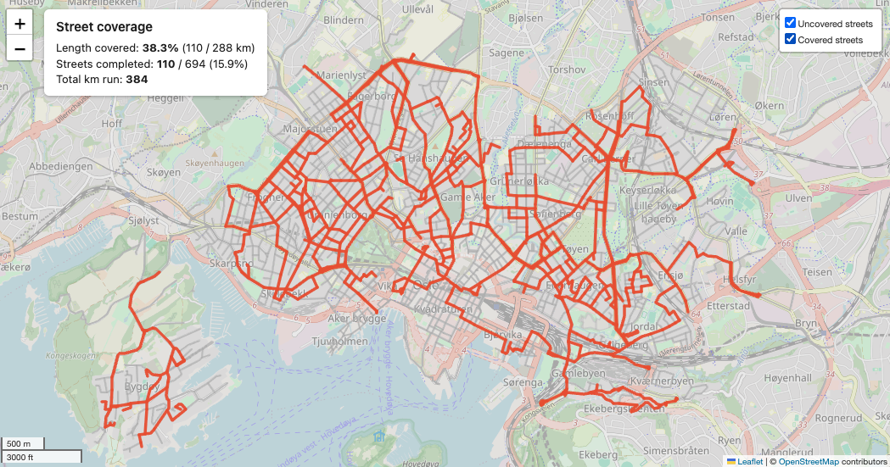

# uncharted

Pulls running activities from the Garmin Connect Personal API, matches GPS tracks
to the OpenStreetMap street network, and renders a map of which streets you have run.

<p align="center">
  
</p>

- Interactive HTML map: streets you have run, coloured by the year you first ran them; the
  rest in grey.
- Coverage by length (km of streets run) and by street (named streets you have completed),
  overall and per district.
- Coverage over time.
- Incremental: new runs are downloaded and matched on top of what you already have.
- Everything stays on your machine.

## Setup

You need [uv](https://docs.astral.sh/uv/) and a Garmin Connect account.

1. **Get a Personal API key.** Create one on the Garmin Connect
   [Personal API token page](https://connect.garmin.com/app/settings/personalApiToken).
   See Garmin's [Personal API overview](https://developer.garmin.com/gc-developer-program/personal/personal-api)
   for what the API offers.
2. **Install and add the key:**
   ```sh
   uv sync
   cp .env.example .env          # put the key after GARMIN_PERSONAL_API_KEY=
   uv run uncharted auth-check   # should print "OK" and when the token expires
   ```

## Usage

The first time, run everything in one go:

```sh
uv run uncharted all
```

and open `data/output/coverage_map.html` in a browser. Run the same command again after new
runs; only new activities are downloaded and matched.

The steps can also be run on their own:

```sh
uv run uncharted sync [--since YYYY-MM-DD] [--full]   # download runs from Garmin
uv run uncharted streets [--refresh]                  # download the street network (cached)
uv run uncharted match [--rebuild]                    # mark streets covered by your runs
uv run uncharted stats                                # print stats, write data/output/stats.json
uv run uncharted render                               # write data/output/coverage_map.html
uv run uncharted all [--since YYYY-MM-DD] [--skip-sync]
```

On the map, hover a street for its name and the year you first ran it, hover a district for
its coverage, and use the layer control (top right) to show your GPS tracks.

### Weekly report

```sh
uv run uncharted report                                     # last full Monday–Sunday week
uv run uncharted report --since 2026-09-01 [--until 2026-09-30]
```

Writes `data/output/report_<start date>.html`: runs and km, new street km, change in coverage,
the streets you completed, the ones you made progress on, per-district changes, and a map of
the area around the period's runs with the new streets highlighted. It also prints a short
text summary. Run `match` first so the latest runs are included.

## Configuration

Defaults are in [`config.toml`](config.toml). Put your own settings in `config.local.toml`
(gitignored); it is merged over the defaults, so it only needs the values you change. For
example, to map another city:

```toml
[area]
place = "Bergen, Norway"     # any place name OpenStreetMap's geocoder knows
crs = "EPSG:25832"           # a metric CRS for the area (UTM zone)
district_admin_level = 9     # OSM admin level of the districts (country-specific)
```

Other settings worth knowing:

| Setting | Default | What it does |
|---|---|---|
| `[sync] activity_types` | `running`, `trail_running` | Garmin activity types to download |
| `[matching] buffer_m` | 20 | How far (m) a GPS track may be from a street and still count |
| `[matching] edge_threshold` | 0.9 | Share of a street segment you must run for it to count as covered |
| `[matching] street_threshold` | 0.9 | Share of a named street you must run for it to count as completed |
| `[streets] include_footways` | false | Also count footways, paths and cycleways (sidewalks are always left out) |

After changing the area or turning footways on, run `streets --refresh` and then
`match --rebuild`.

## How it works

1. **Sync**: lists your activities, downloads the original FIT file for each run and stores
   the metadata in a local SQLite database.
2. **Tracks**: reads GPS points from the FIT files, drops GPS spikes and splits the track
   where the watch was paused, so there are no straight lines across town.
3. **Streets**: downloads runnable streets for the area with
   [osmnx](https://osmnx.readthedocs.io/) (no motorways, private roads or, by default,
   footways), and the district boundaries.
4. **Matching**: a street segment counts as run where your track goes along it, within
   `buffer_m`. Partial runs of the same segment add up over time.
5. **Stats and map**: coverage by length and by named street, overall, per district and over
   time, drawn with [folium](https://python-visualization.github.io/folium/).

**Limitations.** Matching uses distance to the street, not real map matching, so two parallel
streets closer together than `buffer_m` can both be marked as run. GPS that cuts corners can
leave the last few metres of a street unmatched, which can keep a short street just under the
threshold.

## Privacy

Your runs, the downloaded files, the API token and all generated output live in `data/`,
which is gitignored. The API key lives in `.env`, also gitignored. The key, token and API
responses are never logged.

## Development

```sh
uv run pre-commit install   # once: ruff check + format on every commit
uv run pytest
uv run ruff check . && uv run ruff format --check .
```

The tests use synthetic data only and need no API key or network.


## Credits and license

Street data and map tiles © [OpenStreetMap](https://www.openstreetmap.org/copyright) contributors.

MIT licensed; see [LICENSE](LICENSE).
